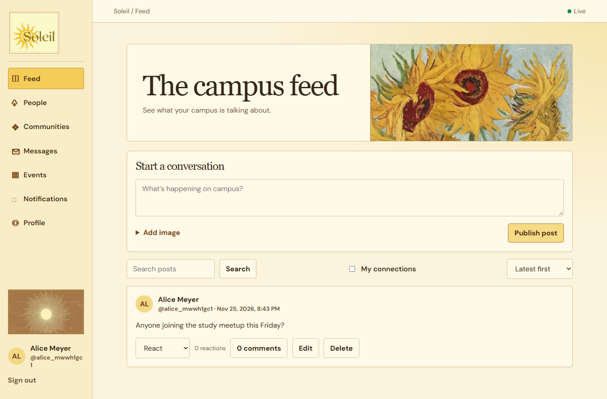
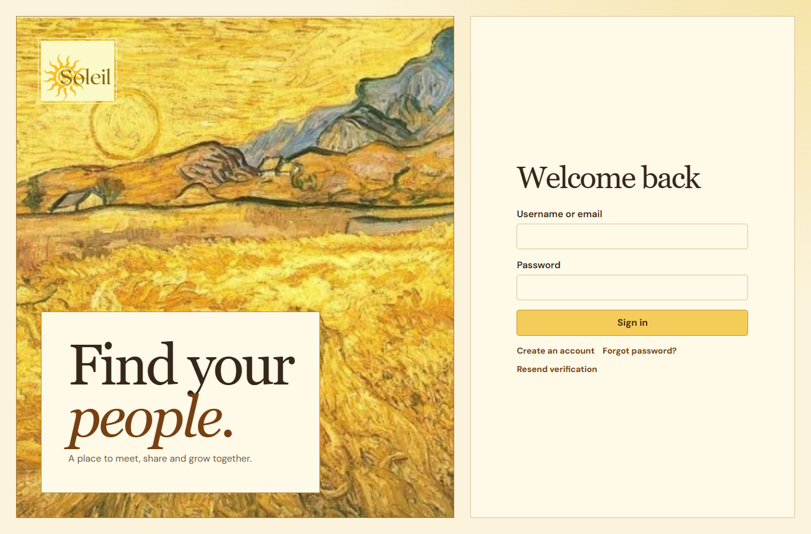
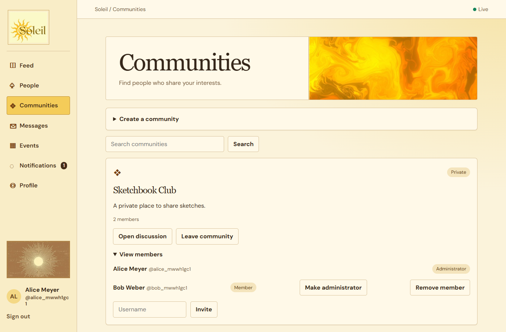
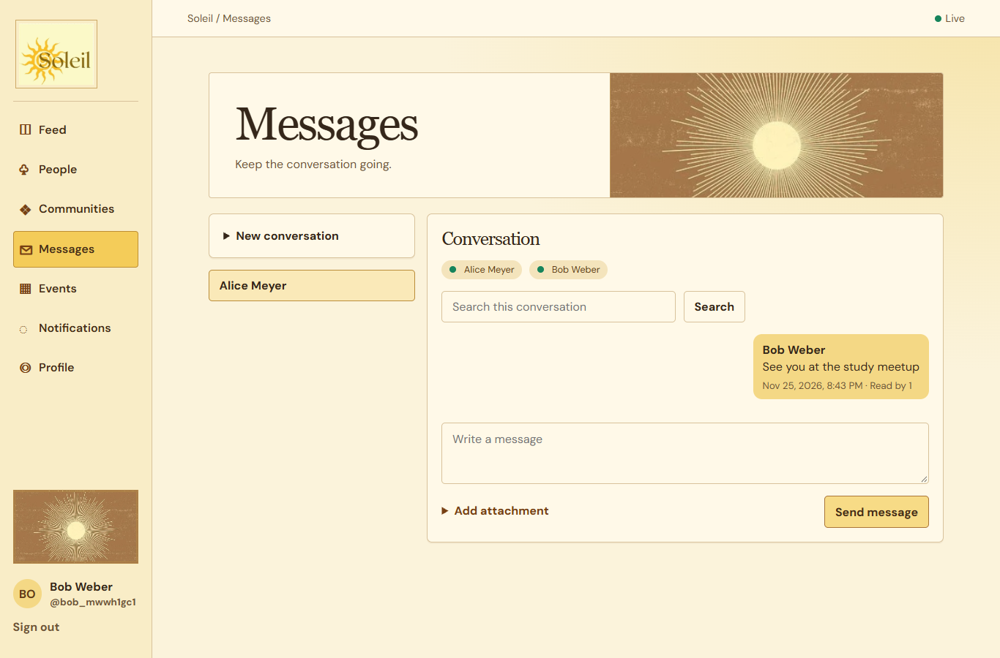
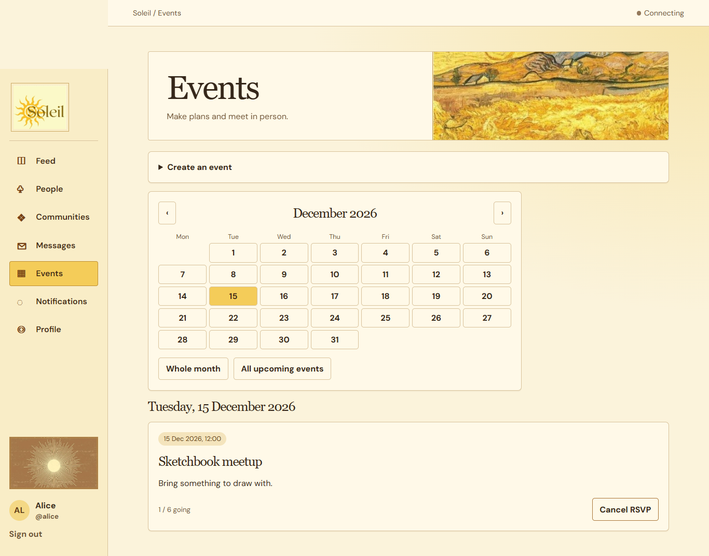
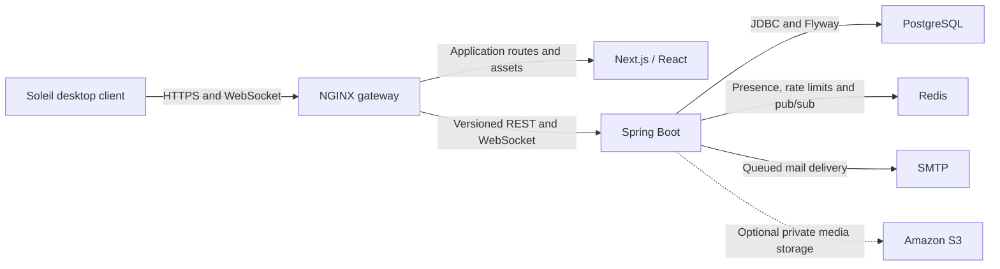

# Soleil

Soleil is a full-stack community application for students and interest groups. It brings profiles, discussions, events and real-time messaging into one workspace. The Windows client opens in its own application window and connects to a local or hosted Soleil service. The React interface preserves Soleil's original sunflower artwork, paintings, logo and warm color palette.



| Account | Communities |
| --- | --- |
|  |  |

| Messaging | Events |
| --- | --- |
|  |  |

[Notifications](docs/screenshots/notifications.png) · [Mobile layout](docs/screenshots/mobile-feed.png)

## Capabilities

| Area | What members can do |
| --- | --- |
| Accounts and profiles | Register, verify an email address, sign in, reset or change a password, edit a profile, upload an avatar or cover image, and control profile visibility. People are shown by display name and `@username`. |
| Connections and feed | Search for people, manage connection requests, publish or edit posts, attach images, react, comment, sort results and filter the feed to accepted connections. |
| Communities | Create public or private groups, browse discussions and member lists, accept invitations and leave groups. Administrators can invite people, change roles, remove members and moderate posts. |
| Events | Create events, browse upcoming events by local day or month, reserve or release a place, and receive reminders. Events in private communities inherit membership restrictions. |
| Conversations | Start one-to-one or group chats with connections, search message history, share files and see online presence, typing, delivery and read receipts. |
| Notifications | See unread counts in real time, filter or mark notifications as read, and open the associated conversation, post, event, community or connection request. |

## Architecture



The backend is a modular monolith. Controllers validate requests and identify the caller. Services apply business rules and transaction boundaries. A shared JDBC repository handles parameterized queries, and Flyway manages the relational schema. PostgreSQL is authoritative for accounts, posts, conversations, events and notifications. Redis handles temporary presence, rate limits, event delivery and optional thumbnail caching. Clients reload persisted results after reconnecting.

Spring Security hashes passwords and validates the issuer, expiration and account version of signed access tokens. Refresh tokens are rotated and stored as digests. A password change revokes existing access and refresh tokens and closes live sessions. Resource authorization applies to private profiles, community and conversation membership, media access, and ownership or moderation of posts. Event reservations acquire database locks before checking capacity. A community must retain an administrator. Removing a member from a private community also releases that member's upcoming reservations there.

See the [architecture notes and ER diagram](docs/architecture.md).

| Layer | Technology |
| --- | --- |
| Windows client | Electron, electron-builder, NSIS |
| Interface | Next.js App Router, React, TypeScript, CSS |
| API and realtime | Java 21, Spring Boot, Spring Security, Spring WebSocket, Jakarta Validation, OpenAPI/Swagger |
| Data | PostgreSQL 17, Spring JDBC, Flyway, Redis |
| Files and mail | JPEG and PNG validation and thumbnails, PDF attachments, PostgreSQL storage or private Amazon S3, SMTP and a database-backed mail queue |
| Delivery and quality | Docker Compose, NGINX, GitHub Actions, GHCR, JUnit 5, Mockito, Testcontainers, Vitest and Playwright |

## Repository layout

| Path | Responsibility |
| --- | --- |
| [`desktop/`](desktop/) | Windows application window, server configuration, account-link handling, packaging and smoke tests. |
| [`frontend/`](frontend/) | Interface, application routes, HTTP and WebSocket client, original artwork and browser tests. |
| [`backend/`](backend/) | API, security, domain services, jobs, metrics, migrations and Java tests. |
| [`infra/`](infra/) | Gateway configuration and production Compose overrides. |
| [`.github/workflows/`](.github/workflows/) | Build checks, end-to-end tests, Windows installer packaging and deployment. |
| [`docs/`](docs/) | Architecture, ER diagram, screenshots and legacy notes. |
| [`src/`](src/) | Original JavaFX application, retained with its Gradle entry points. |

## Quick start

**Prerequisites.** Docker with the Compose plugin for the local service. Use Node.js 24 to build or test the frontend or Windows client. Use Java 21 and Maven 3.9 to build or test the API outside Docker.

From the repository root, copy `.env.example` to `.env` and set independent values for `POSTGRES_PASSWORD` and `JWT_SECRET`. The JWT secret needs at least 32 bytes. Keep `.env` local.

### Windows application

```powershell
npm ci --prefix desktop --ignore-scripts
node desktop/node_modules/electron/install.js
.\Start-Soleil.ps1
```

The launcher starts the local service, waits for readiness and opens Soleil. To connect to an existing service, run `.\Start-Soleil.ps1 -Server https://soleil.example`. The installed client accepts `--server=https://soleil.example`, `SOLEIL_SERVER`, or a `server.json` file under `%APPDATA%\Soleil` containing `{"server":"https://soleil.example"}`. The local default is `http://localhost:3000`.

From Windows, run `npm run package --prefix desktop` to generate the x64 installer. The [Windows packaging workflow](.github/workflows/desktop.yml) also creates and smoke-tests its build artifact. The installer contains the client and connects to the configured service. Local installers are unsigned unless a signing certificate is configured.

### Start only the service

```sh
docker compose up --build --wait
```

| Local endpoint | Purpose |
| --- | --- |
| [localhost:3000](http://localhost:3000) | Application entry point and desktop client origin. |
| [localhost:8025](http://localhost:8025) | Mailpit inbox for development email. |
| [Swagger UI](http://localhost:3000/swagger-ui/index.html) | Interactive API documentation. |
| [OpenAPI JSON](http://localhost:3000/v3/api-docs) | Machine-readable API schema. |
| [Readiness](http://localhost:3000/actuator/health/readiness) | Service readiness including PostgreSQL and Redis. |

### Try the main workflows

1. Create an account and open its verification message in Mailpit. In the desktop client, copy the full link and use **Soleil → Open copied verification or reset link**.
2. Sign in, open **Profile**, and edit your profile or account settings.
3. Create a second account in a separate browser profile. Send a connection request from **People** and accept it on the other account. Open **Messages** to verify live delivery and read receipts.
4. Create a private community, invite the second account, and accept the invitation through **Notifications**. Open its discussion or create an event and try reserving a place.

Use `docker compose down` to stop the local service while keeping its database volume.

### Existing databases

A retired optional migration left a gap at version 2. Fresh databases apply the current migration set automatically. If an existing Flyway history already contains version 2, back up that database and review `flyway info`. Run `flyway repair` against the correct database using the migration directory in this checkout after confirming the retired version is the only mismatch. Do this before starting the updated application. The change leaves existing application records intact.

The original JavaFX app uses a separate database configuration. Its source and [setup notes](docs/legacy-javafx.md) remain available. Existing JavaFX records need a separate export and account mapping to import into Soleil.

## Tests and verification

```sh
mvn -f backend/pom.xml verify

npm ci --prefix frontend
npm test --prefix frontend
npm run build --prefix frontend
npm exec --prefix frontend -- playwright install chromium
npm run e2e --prefix frontend

npm test --prefix desktop
```

Run the browser suite with the service and development inbox already running. `E2E_ORIGIN` and `E2E_MAIL` override their local URLs. The suite uses separate sessions to check email verification, publishing, connection requests, live messaging and receipts, private community invitations and removal, and password changes. The backend integration suite uses isolated database and Redis containers.

| Check | Verified result |
| --- | --- |
| Backend package and JUnit | Build succeeded, 3 unit tests passed. |
| Frontend build and Vitest | Production build succeeded, 6 unit tests passed. |
| Playwright | 2 end-to-end scenarios passed against Spring Boot, PostgreSQL, Redis and a local SMTP receiver. |
| Windows client | 2 configuration/link tests passed. The packaged executable passed a launch and navigation smoke test. |
| Database upgrade | Validated the current migrations on a fresh database and checked the documented repair procedure on a disposable previous-schema database. Existing records survived the upgrade. |
| Testcontainers | Four integration scenarios are configured. This workstation had no Docker daemon, so its Testcontainers run was skipped. |

These are functional verification results. Response time and throughput depend on the deployment and test load.

## Metrics and operations

| Surface | What it reports |
| --- | --- |
| `GET /actuator/health/liveness` | Whether the application process can respond. |
| `GET /actuator/health/readiness` | Whether the application is ready and its PostgreSQL and Redis dependencies are available. |
| `GET /api/v1/admin/status` | Totals for API requests and HTTP 5xx errors, mean response time in milliseconds, process uptime, active and maximum database connections, and pending and failed mail counts. Requires the global administrator role. |
| Structured logs | JSON logs on standard output. Collect these from the backend container or process. |

Request totals cover the life of the current process and exclude readiness probes and administrator endpoints. An unavailable measurement is reported as null. API metrics and role restrictions were verified on the local running stack.

## Deployment

- [CI](.github/workflows/ci.yml) runs Java and frontend builds, unit tests and an end-to-end Compose job on pushes and pull requests.
- [Windows packaging](.github/workflows/desktop.yml) uploads an installer as a workflow artifact. Keep generated binaries, dependencies, local configuration and build output out of source commits.
- [Publish and deploy Soleil](.github/workflows/deploy.yml) builds backend and frontend images and publishes commit-tagged images to GHCR. A configured `production` environment can deploy the same images to an SSH host.

Prepare the host with Docker Compose, registry access, a `campus/` deployment directory and a private `.env`. Set the public HTTPS `APP_ORIGIN`, database and JWT secrets, and production SMTP settings. Put the loopback gateway behind a TLS proxy that forwards the public host, protocol and WebSocket upgrades. Configure GitHub environment variables `DEPLOY_HOST` and `DEPLOY_USER`, and secrets `DEPLOY_SSH_KEY` and `DEPLOY_KNOWN_HOSTS`.

For private object storage, set `S3_BUCKET` and `AWS_REGION` and supply credentials through the workload environment. Without a bucket, uploaded bytes are stored in PostgreSQL. Uploaded files are limited to 5 MiB and download access follows the associated profile, post or conversation permissions.

The deployment and S3 configuration are available for a target environment. The repository's recorded verification covers the local stack.
