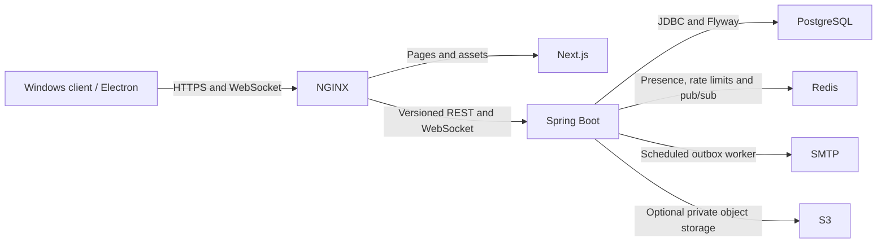
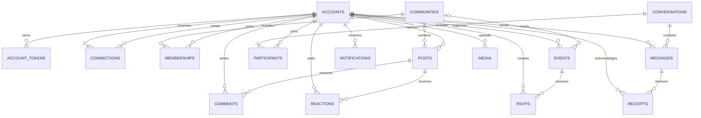

# Soleil architecture

Each domain has an HTTP controller and business service. The Spring Boot monolith shares a JDBC repository and PostgreSQL transaction manager across domains. PostgreSQL enforces relationships and uniqueness. The event RSVP transaction locks the event row before counting attendees. Chat and notification changes publish Redis events after commit. Reconnecting clients reload persisted history and notifications.

Community membership changes lock the community row before modifying roles or removing members. Private event RSVP claims and creation of community posts and events acquire a shared lock first. This keeps permission checks consistent with membership changes and releases upcoming private RSVP places when members leave or are removed. Unread notification counts use a partial PostgreSQL index scoped by recipient.

The API uses `/api/v1` and an OpenAPI schema. Access JWTs live in memory in the browser and expire after ten minutes. Refresh tokens rotate, are stored as digests in PostgreSQL, and are sent in an HttpOnly cookie. Resetting a password increments the account token version and revokes refresh tokens. Resource access checks enforce profile visibility, conversation membership, private group membership and ownership. The WebSocket authenticates with an initial frame and is restricted to the configured browser origin.

Redis stores expiring presence and request counters. For S3 uploads, it caches immutable thumbnails behind the same authorization checks as originals. PostgreSQL is authoritative for history and notifications. Pub/sub events can be missed by disconnected clients. Structured application logs go to stdout. The administrator status endpoint reports mail jobs that exhausted their retries.

## Relationships

Search uses trigram GIN indexes on user names, group names/descriptions and post/message bodies. Feed, chat history and notifications use bounded pages and deterministic ordering. Messages use a text representation of their bigint key at the JSON boundary.
